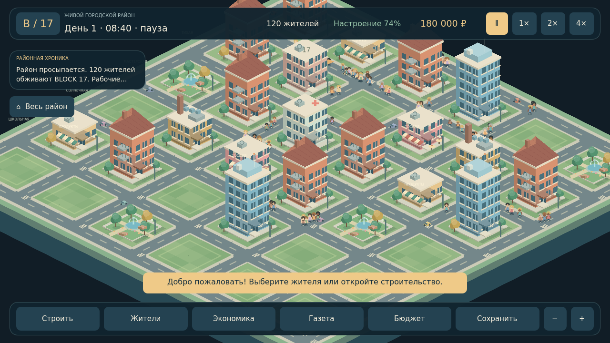

# BLOCK 17 — живой район

Одиночная офлайн-игра для Android на **Godot 4.6.3**. Играбельная версия **0.1.0**: 120 самостоятельных жителей, связанная экономика, строительство, отношения и районная газета.



**[Скачать APK и BLOCK-17-Android.zip](https://github.com/elcin31/BLOCK-17/releases/latest)** · **[Сборки GitHub Actions](https://github.com/elcin31/BLOCK-17/actions/workflows/android.yml)** · [Результаты проверок](docs/TEST-REPORT.md)

## Что можно делать

- Наблюдать за 120 людьми: у каждого имя, возраст, внешность, характер, дом, профессия, кошелёк, потребности, цель, семья, друзья, конфликты и личный дневник.
- Выбрать жителя на улице или через поиск, читать его историю и следовать за ним камерой. Люди идут по дорожной сети на работу, в школу, магазин, поликлинику, сквер и домой.
- Строить два вида жилья, магазины, кафе, офисы, мастерские, школу, поликлинику, парки и дороги. Здания создают рабочие места; новое жильё уменьшает арендное давление; скверы восстанавливают силы и помогают встречам.
- Управлять налогом на доходы, читать бюджет и поддерживать предприятия. Зарплаты зависят от работы и денег в кассе. Магазины получают выручку от жителей, офисы и мастерские — от внешних заказов.
- Видеть последствия: сокращения, финансовые трудности, новые друзья и семьи, переезды домохозяйств, собственный бизнес жителей, развитие и упадок улиц.
- Ставить паузу, выбирать 1× / 2× / 4×, сохранять район в трёх слотах. Автосохранение — раз в минуту и при сворачивании. Повреждённый основной файл восстанавливается из предыдущей проверенной копии.

Изометрическая графика рисуется оригинальными векторными архитектурными формами: фасады, балконы, оконные рамы, крыши, трубы, маркизы, фонтаны, скамейки, деревья и фонари. Персонажи отличаются одеждой, волосами, оттенком кожи и возрастом; ходьба анимирована. Есть дневное и ночное освещение, огни окон, декоративные автомобили и тихая процедурная звуковая атмосфера.

## Установка и управление

**Android 7.0+**, OpenGL ES 3.0, ARM64 / ARMv7 / x86_64. Только альбомная ориентация. Для Xiaomi Redmi Note 12 подходит ARM64; замеры на физическом устройстве пока не выполнены.

1. Скачайте `BLOCK-17-Android.zip` из Releases и распакуйте.
2. Откройте `BLOCK-17.apk`, разрешите установку из выбранного приложения и установите.
3. Нажмите «Новая игра». Перетаскивайте карту, меняйте масштаб двумя пальцами или кнопками `+ / −`, касайтесь людей и зданий.
4. В «Строить» выберите проект, затем участок с `+`. Для дороги выберите свободную клетку рядом с существующей улицей.
5. `B / 17` открывает главное меню. Кнопка Android «Назад» закрывает панель или открывает меню. Правила района доступны в «Настройки → Как живёт район».

Пакет `org.block17.livingcity`. Сборка подписана **ключом разработки**, предназначена для прямой установки. В CI ключ создаётся заново: при смене подписи Android потребует удалить предыдущую версию, что удалит её сохранения. Для постоянных обновлений нужен собственный стабильный ключ подписи. Интернет, учётная запись, разрешения на сеть и платные сервисы не требуются.

## Как устроена экономика

Один день занимает 144 секунды при 1×. Модель считает игровую минуту за шаг, независимо от частоты отрисовки.

| Время | Событие |
| --- | --- |
| 08:00–17:00 | Работа, учёба, покупки по потребностям |
| 11:00 | Проверка возможности открыть собственный бизнес |
| 12:00 | Отчёт о состоянии улиц |
| 18:00 | Зарплаты, налоги, внешние заказы, пособия и пенсии |
| 19:00 | Встречи находящихся рядом людей, дружба, конфликты, семьи |
| 21:00 | Аренда, семейные переводы детям, содержание города |
| 22:00 | Возможный переезд домохозяйства; ночной отдых |
| 00:00 | Суточный бюджетный отчёт |

Налог регулируется: 8%, 12%, 18%. Аренда зависит от отношения населения к вместимости жилья. Безработные ищут вакансии, амбициозные люди рассматривают более высокую зарплату. Житель с целью открыть бизнес и накоплениями от 6 500 ₽ инвестирует личные деньги в свободный участок. Встречи требуют физической близости, а перемещение семьи учитывает вместимость нового дома.

Это компактная модель района, а не полноценная макроэкономическая модель. Цены и базовые зарплаты фиксированы; внешние заказы моделируются как источник денег извне. Население фиксировано — рождения, смерти, старение и приток новых жителей в этой версии не реализованы. Автомобили декоративные. Редактор произвольных зданий, снос, многоэтажные интерьеры, товарные склады и цепочки производства не входят в версию 0.1.0.

## Исходный код и локальный запуск

Откройте `project.godot` в **Godot 4.6.3 Standard**, дождитесь импорта и запустите сцену `scenes/main.tscn`. Десктопный запуск предназначен для разработки; публикуемый пакет — только Android.

```sh
godot --headless --path . --editor --import --quit
XDG_DATA_HOME="$PWD/builds/test-data" godot --headless --path . --script tests/test_simulation.gd
XDG_DATA_HOME="$PWD/builds/test-data" godot --headless --path . --script tests/test_ui.gd
```

Для проверки реальной отрисовки и получения скриншотов:

```sh
XDG_DATA_HOME="$PWD/builds/test-data" xvfb-run -a godot --path . --audio-driver Dummy --rendering-method gl_compatibility --script tests/test_ui.gd
```

## Сборка APK

Workflow `.github/workflows/android.yml` запускается при push в `main`, pull request и вручную. Он устанавливает Godot, Java 21, Android SDK 36 и Build Tools 36.0.0, импортирует ресурсы, выполняет тесты, экспортирует и проверяет подписанный APK, затем создаёт `BLOCK-17-Android.zip` с инструкцией и SHA-256. Дополнительный этап на Android 11 с KVM устанавливает APK, отключает сеть, проверяет запуск, касания, отрисовку, автосохранение и восстановление после остановки процесса. Готовые файлы — в артефакте `BLOCK-17-Android`; логи и снимки — в `BLOCK-17-Test-Results`.

Для локальной сборки в Linux установите Java 21 и Android SDK с `platform-tools`, `platforms;android-36`, `build-tools;36.0.0`. Из официального `Godot_v4.6.3-stable_export_templates.tpz` извлеките `android_debug.apk` и `android_release.apk` в `.tools/export_templates/4.6.3.stable/`.

```sh
mkdir -p .tools builds
keytool -genkeypair -keystore .tools/debug.keystore -storepass android \
  -alias androiddebugkey -keypass android -keyalg RSA -keysize 2048 \
  -validity 10000 -dname 'CN=BLOCK17 Development,O=BLOCK17,C=US'
export GODOT_ANDROID_SDK="/absolute/path/to/android-sdk"
export GODOT_JAVA_HOME="/absolute/path/to/java-21"
export GODOT_ANDROID_KEYSTORE="$PWD/.tools/debug.keystore"
python3 tools/configure_android.py
godot --headless --path . --export-debug Android builds/BLOCK-17.apk
"$GODOT_ANDROID_SDK/build-tools/36.0.0/apksigner" verify --verbose builds/BLOCK-17.apk
python3 tools/package_android.py
```

Ключи, SDK, шаблоны и сборки исключены из git. Сохранения находятся в приватном каталоге данных приложения, имеют версию схемы, контрольную сумму, атомарную запись и резервную копию. Автоматические тесты следует запускать с отдельным `XDG_DATA_HOME`, как в примерах, чтобы не затронуть игровые слоты.

## Структура

| Файл | Назначение |
| --- | --- |
| `scripts/simulation.gd` | Детерминированная модель жителей, денег, маршрутов и событий, без SceneTree |
| `scripts/catalog.gd` | Каталог проектов, параметры и изометрическая проекция |
| `scripts/city_view.gd` | Камера, касания, выбор, интерполяция, транспорт, суточное освещение |
| `scripts/terrain.gd` | Кэшируемый слой земли, дорог и участков |
| `scripts/architecture.gd` | Детализированная архитектура и озеленение |
| `scripts/resident_view.gd` | Внешность и анимация персонажей |
| `scripts/main.gd` | Русский интерфейс, игровые команды, звук и жизненный цикл Android |
| `scripts/save_store.gd` | Слоты, проверка данных, атомарная запись и восстановление |
| `tests/` | Длительная симуляция, экономика, сохранения, интерфейс |

Графика зданий и земли перерисовывается только при изменении города или переходе день/ночь. Движение интерполируется; журналы ограничены по размеру; генератор случайных чисел сохраняет точное 64-битное состояние строкой. Это исключает потерю последовательности решений после JSON-загрузки.

Шрифт DejaVu Sans распространяется по лицензии в `assets/FONT-LICENSE.txt`. Код и процедурная графика созданы для этого репозитория; сторонние игровые ассеты и сетевые SDK не используются.
